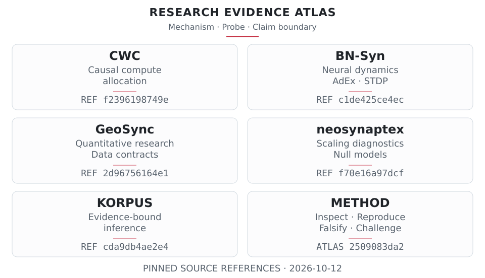

  <picture>
    <source media="(prefers-color-scheme: dark)" srcset="./assets/neuro-code-dark.webp">
    
  </picture>

<!-- Theme derivatives preserve the original motion and timing. Keep assets/neuro-code.webp unchanged as the source. -->

<h1 align="center">Yaroslav Vasylenko</h1>

  <strong>Independent NeuroAI Researcher · AI Systems Architect</strong> 
  Computational neuroscience · Cognitive architectures · Technical AI safety

  <a href="#selected-research">Research</a> ·
  <a href="#engineering-practice">Engineering</a> ·
  <a href="#collaborate">Collaborate</a>

I translate neural and cognitive mechanisms into computational models,
constrained controllers, and reproducible evaluation systems. My research
asks which adaptive mechanisms change behavior under controlled interventions
and explicit compute budgets—and where those mechanisms fail.

At the AI systems layer, I build explicit control around probabilistic
generation: typed contracts, bounded authority, fail-closed decisions,
and replayable evidence.

**Ukraine · Independent research · Remote collaboration**

## Selected research

  <a href="./RESEARCH_ATLAS.md">
    <picture>
      <source media="(max-width: 600px) and (prefers-color-scheme: dark)" srcset="./assets/research-atlas-mobile-dark.svg">
      <source media="(max-width: 600px)" srcset="./assets/research-atlas-mobile-light.svg">
      <source media="(max-width: 1100px) and (prefers-color-scheme: dark)" srcset="./assets/research-atlas-compact-dark.svg">
      <source media="(max-width: 1100px)" srcset="./assets/research-atlas-compact-light.svg">
      <source media="(prefers-color-scheme: dark)" srcset="./assets/research-atlas-dark.svg">
      
    </picture>
  </a>

  <a href="./RESEARCH_ATLAS.md#cwc">CWC</a> ·
  <a href="./RESEARCH_ATLAS.md#bnsyn">BN-Syn</a> ·
  <a href="./RESEARCH_ATLAS.md#geosync">GeoSync</a> ·
  <a href="./RESEARCH_ATLAS.md#neosynaptex">neosynaptex</a> ·
  <a href="./RESEARCH_ATLAS.md#korpus">KORPUS</a>

Each project has a commit-pinned route to its mechanism, reproduction guide,
adversarial probe or counterexample, and claim boundary. The atlas makes
the source revision explicit and keeps the limits of the evidence visible.

  <a href="./RESEARCH_ATLAS.md"><strong>Explore the atlas →</strong></a> ·
  <a href="https://github.com/neuron7x/neuron7x/issues/new?template=research-challenge.yml">Challenge a result</a>

CWC builds on [Andrej Karpathy's nanochat](https://github.com/karpathy/nanochat).
The original contribution is the CWC research, instrumentation, and evaluation
layer; upstream attribution is preserved in the repository.

## Engineering practice

I work from **mechanism → invariant → falsifier → evidence**.

- **Causal evaluation:** controlled interventions, ablations, matched baselines,
  and explicit limits on inference.
- **Neural and cognitive systems:** dynamical models, constrained autonomy,
  and inspectable state transitions.
- **Agent reliability:** tool boundaries, structured outputs, policy gates,
  and separation of generation from acceptance.
- **Software assurance:** property-based and mutation testing, deterministic
  replay, schema validation, provenance, and CI gates.

**Core tools:** Python · NumPy / SciPy · FastAPI / Pydantic ·
pytest / Hypothesis · Docker · Linux · GitHub Actions / GitLab CI

<strong>Evidence and scope</strong>

Experimental findings are conditional on their documented substrates,
datasets, interventions, and compute budgets. Negative results remain part
of the research record.

CWC's budgeted-computation programme and BN-Syn's neural simulations remain
research work. KORPUS distinguishes engineering checks from production
authorization. The neosynaptex canon records why an estimated γ ≈ 1 alone
cannot establish criticality or metastability.

Current status and supporting evidence belong to the linked project sources.
Independent replication and deployment require their own evidence.

## Collaborate

Open to research collaboration and focused engineering engagements in
NeuroAI, cognitive architectures, technical AI safety evaluation, and
agent reliability.

[Email](mailto:neuron7x@gmail.com) ·
[Telegram](https://t.me/neuron7x) ·
[NEURON7X services](https://neuron7x-site-140887.gitlab.io/)

  <picture>
    <source media="(prefers-color-scheme: dark)" srcset="./assets/research-signature-dark.svg">
    
  </picture>

⊛ Vita est certamine.

