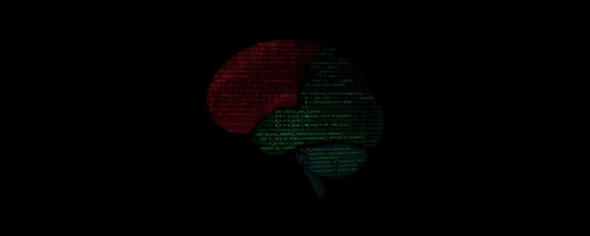
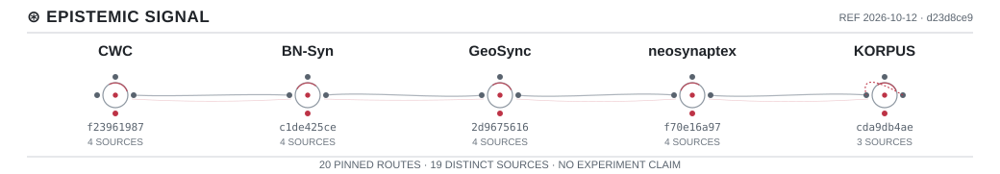

  

<!-- The original brain animation is intentional. Preserve its file and reference. -->

<h1 align="center">Yaroslav Vasylenko</h1>

  Independent NeuroAI Researcher · AI Systems Architect 
  Neural dynamics · Causal identification · Technical AI safety

I study when an adaptive system's behavior supports an inference about
its mechanism—and when the evidence cannot distinguish competing explanations.

My work spans computational neuroscience, cognitive architectures, and
reliable AI systems. The approach is consistent: state the assumptions,
test interventions, search for counterexamples, and preserve the limits
of each claim.

### Research

  <a href="./RESEARCH_ATLAS.md">
    <picture>
      <source media="(max-width: 600px) and (prefers-color-scheme: dark)" srcset="./assets/research-atlas-mobile-dark.svg">
      <source media="(max-width: 600px)" srcset="./assets/research-atlas-mobile-light.svg">
      <source media="(max-width: 1100px) and (prefers-color-scheme: dark)" srcset="./assets/research-atlas-compact-dark.svg">
      <source media="(max-width: 1100px)" srcset="./assets/research-atlas-compact-light.svg">
      <source media="(prefers-color-scheme: dark)" srcset="./assets/research-atlas-dark.svg">
      
    </picture>
  </a>

  <a href="./RESEARCH_ATLAS.md#cwc">CWC</a> ·
  <a href="./RESEARCH_ATLAS.md#bnsyn">BN-Syn</a> ·
  <a href="./RESEARCH_ATLAS.md#geosync">GeoSync</a> ·
  <a href="./RESEARCH_ATLAS.md#neosynaptex">neosynaptex</a> ·
  <a href="./RESEARCH_ATLAS.md#korpus">KORPUS</a>

Five selected projects, with source-pinned routes to a mechanism,
reproduction guide, adversarial probe or counterexample, and claim boundary.
A source reference establishes provenance; it does not establish that
an experiment was executed or independently replicated.

  <a href="./RESEARCH_ATLAS.md">Inspect the evidence</a> ·
  <a href="https://github.com/neuron7x/neuron7x/issues/new?template=research-challenge.yml">Challenge a result</a>

CWC extends <a href="https://github.com/karpathy/nanochat">Andrej Karpathy's nanochat</a>.
Its research, instrumentation, and evaluation layer is distinct from
the attributed upstream work.

### Inference

A bounded, deterministic gate compares declared candidate models with
supplied observations. It can propose a discriminating intervention,
reject the declared model class, or abstain. Selecting one surviving
model does not grant causal authority.

[Inference protocol](./INFERENCE_RUNTIME.md) ·
[Executable kernel](./inference/kernel.mjs) ·
[Falsification traces](./inference/results/)

### Engineering

Probabilistic generation proposes. Deterministic contracts govern acceptance.

Mechanism → assumption → falsifier → evidence → admissible decision.

I build inspectable model and tool boundaries: typed interfaces,
bounded authority, reproducible runs, and explicit failure conditions.
The standard is not a plausible answer, but an outcome that can be
tested against a declared contract.

Methods, tooling, and evidence limits

Controlled interventions, ablations, matched baselines, dynamical
simulation, property-based and mutation testing, deterministic replay,
and source-level provenance.

Python · NumPy / SciPy · FastAPI / Pydantic · pytest / Hypothesis ·
Docker · Linux · Git / GitLab CI

CWC's causal candidates remain conditional on identifying assumptions.
BN-Syn's numerical properties do not establish biological fidelity.
The neosynaptex γ ≈ 1 marker is not, by itself, evidence of criticality.
KORPUS distinguishes engineering checks from release authorization.
Independent replication and deployment require separate evidence.

### Collaborate

Independent research from Ukraine. Open to focused collaborations in
NeuroAI, cognitive architectures, technical AI safety, and
evidence-bound agent engineering.

[Email](mailto:neuron7x@gmail.com) ·
[Telegram](https://t.me/neuron7x) ·
[Engineering services](https://neuron7x-site-140887.gitlab.io/)

  <a href="./EVIDENCE_INTERFACE.md">
    <picture>
      <source media="(max-width: 600px) and (prefers-color-scheme: dark)" srcset="./assets/epistemic-signal-mobile-dark.svg">
      <source media="(max-width: 600px)" srcset="./assets/epistemic-signal-mobile-light.svg">
      <source media="(prefers-color-scheme: dark)" srcset="./assets/epistemic-signal-dark.svg">
      
    </picture>
  </a>

⊛ Vita est certamine.

