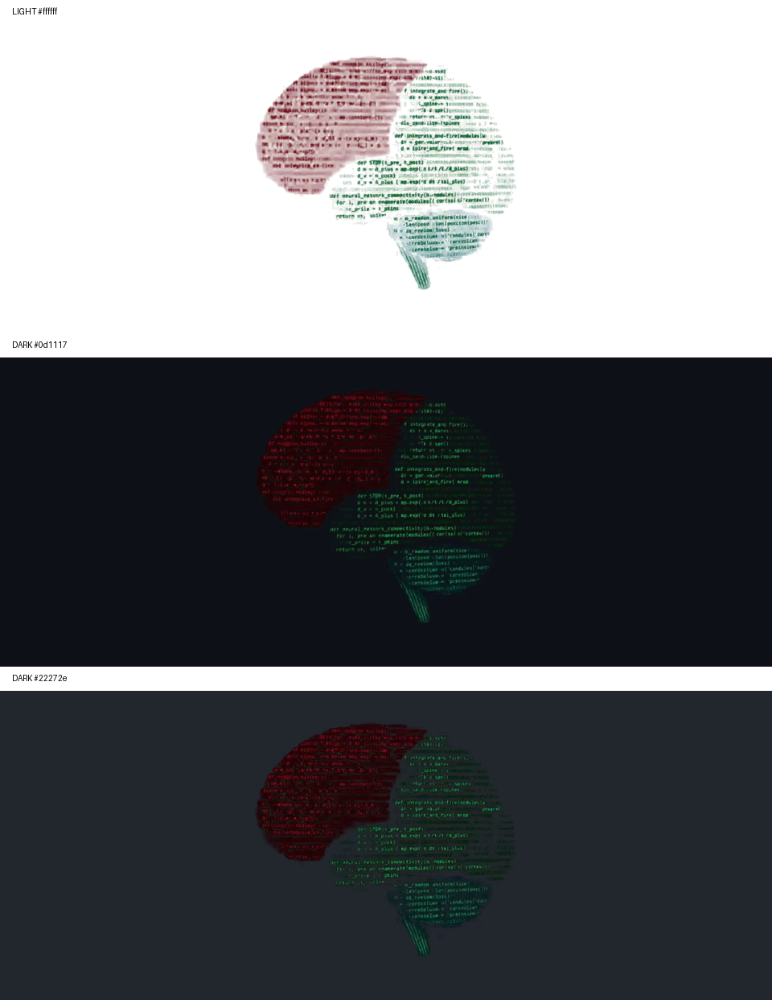

# Brain theme integration — prepared, not deployed



The live profile and original animation are unchanged. This branch contains the renderer and a frame-237 compositing preview. The generated animated binaries are not in this branch: connector upload failed for the large files, and GitHub Actions could not start because GitHub reported an account billing lock.

Locally verified output: 475 frames, 1200 × 480, 39,583 ms, every original frame duration and infinite looping preserved. Canvas edges are fully transparent. Colour adaptation is lossy; pixel identity is not claimed. The dark file is 22.3 MB and the light file 24.8 MB, compared with the 7.4 MB original.

To finish from a local checkout, run `python tools/render_brain_transparency.py` with Pillow 12.3.0 and NumPy 2.3.5, add both generated WebP files and the JSON report, and replace only the first image in README with:

```html
<p align="center">
  <picture>
    <source media="(prefers-color-scheme: dark)" srcset="./assets/neuro-code-dark.webp">
    
  </picture>
</p>
```

Retain `assets/neuro-code.webp` unchanged as the source. The self-contained download package also contains already-generated binaries and a checksum-guarded application helper, so rerendering is optional.
